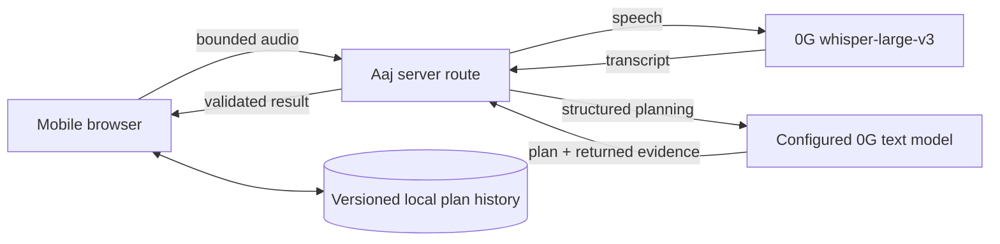

# Aaj

**Speak your day. Leave with a plan.**

Aaj (आज, “today” in Hindi) is a planned mobile-first PWA for people who have a full head and an empty planner. A 30–60 second multilingual voice note becomes exactly:

- three priorities;
- one blocker;
- one first step; and
- one short encouragement.

## The problem

Most planning tools ask users to sort their thoughts before the tool can help. That is highest friction when the day is already overloaded, and it is especially unnatural for people who think or speak across languages.

Aaj makes one narrow promise: say what is on your mind, then receive a small plan you can begin today—not a transcript to organize, a blank form, or an open-ended chat.

## Intended flow

1. Record or upload a short voice note.
2. Aaj’s server sends the audio to 0G `whisper-large-v3` for transcription.
3. A server-configured 0G text model turns the transcript into the fixed plan shape. The default remains TBD until real model availability is verified.
4. The result shows per-stage 0G request IDs only when those exact IDs were returned by the provider.
5. The browser stores the structured plan and completion state by local date; Aaj does not retain raw audio or server-side history.
6. Return tomorrow for a new plan and the recent progress on this device.

## Why 0G matters

0G is planned as the critical inference path, not a logo or optional enhancement. Remove both planned 0G calls and Aaj loses its transcript, structured plan, and provider evidence—the product’s core output.

The architecture is also candidly **technically replaceable**: provider-specific behavior sits behind a server adapter so Aaj is not permanently coupled to one API. Replaceability does not make the hackathon integration superficial. The working submission must prove its speech and planning path against real 0G calls, expose authentic evidence semantics, and document the observed API/model behavior. Another provider would require a different adapter, privacy review, validation, and evidence contract.

## Planned architecture

`ZERO_G_API_KEY` will be server-only. Aaj will validate uploads and model output, avoid content-bearing logs, and return typed errors. The text model, exact 0G request shape, request-ID locations, supported audio formats, timeouts, and provider privacy wording are implementation assumptions to verify—not completed facts.

## Scope

### MVP

- Mobile-first recording with file-upload fallback.
- 0G speech transcription plus structured plan generation.
- Exact plan cardinality and strict validation.
- Honest per-stage evidence: authentic request ID or unavailable.
- Priority completion and date-keyed browser history.
- Accessible loading, error, result, history, and erase states.
- Optional explicit demo mode that can never masquerade as real inference.

### Not in the MVP

- General chat, coaching, therapy, or automatic task execution.
- Accounts, cloud sync, collaboration, calendar/task-manager integrations, notifications, wallets, contracts, or blockchain storage.
- Native mobile apps or iAI login.
- Claims of encrypted local storage, zero provider retention, or cryptographic verification without evidence.

## Privacy and security position

Aaj is local-first for **history**, not device-only for **inference**. In real mode, current audio and transcript must cross the Aaj server boundary and be sent to 0G. The intended implementation does not retain raw audio, transcript, or plan history on the Aaj server; structured plans and completion state remain in browser storage. Browser storage is not a secure vault and is lost if site data is cleared.

Aaj will state its own retention behavior separately from 0G’s policies. It will not claim provider guarantees until current documentation and observed behavior support them. Secrets must never enter client bundles, responses, logs, or Git history.

Demo mode, if implemented, must be explicitly enabled and persistently say **“Demo mode — no 0G inference occurred.”** It contains no provider request IDs or real model labels. A missing API key is an error, not an automatic simulation switch.

## Prize target

Aaj targets exactly one partner prize: **0G — Build with 0G Private Computer (Classic)**. The single-prize strategy keeps the build focused on a complete, judge-tryable consumer loop with real 0G inference and inspectable request evidence.

## Project status

**Planning foundation complete; application implementation has not started.**

There is currently no application code, package manifest, live deployment, executed test suite, verified 0G request, selected live text model, or real request ID in this repository. Setup and run commands will be added only after code exists and those commands work from a clean checkout.

## Documentation

- [Product requirements](docs/prd.md)
- [High-level design](docs/hld.md)
- [Normative MVP specification](docs/spec.md)
- [TDD implementation plan and issue-ready backlog](docs/implementation-plan.md)
- [Demo script draft](docs/demo-script.md)
- [Submission draft](docs/submission.md)
- [Research and decision basis](docs/research.md)
- [AI assistance ledger](docs/ai-assistance.md)
- Architecture decisions:
  - [ADR-0001: Single 0G prize](docs/adr/0001-single-0g-prize.md)
  - [ADR-0002: Web PWA over native](docs/adr/0002-web-pwa-over-native.md)
  - [ADR-0003: Local-first history](docs/adr/0003-local-first-history.md)
  - [ADR-0004: No fake evidence](docs/adr/0004-no-fake-evidence.md)
