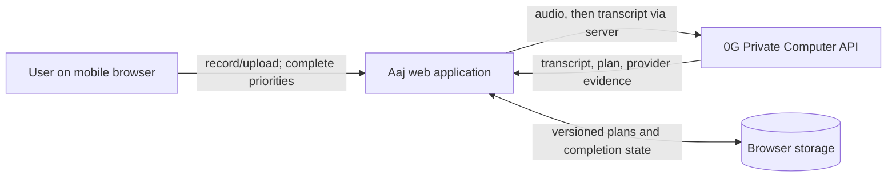
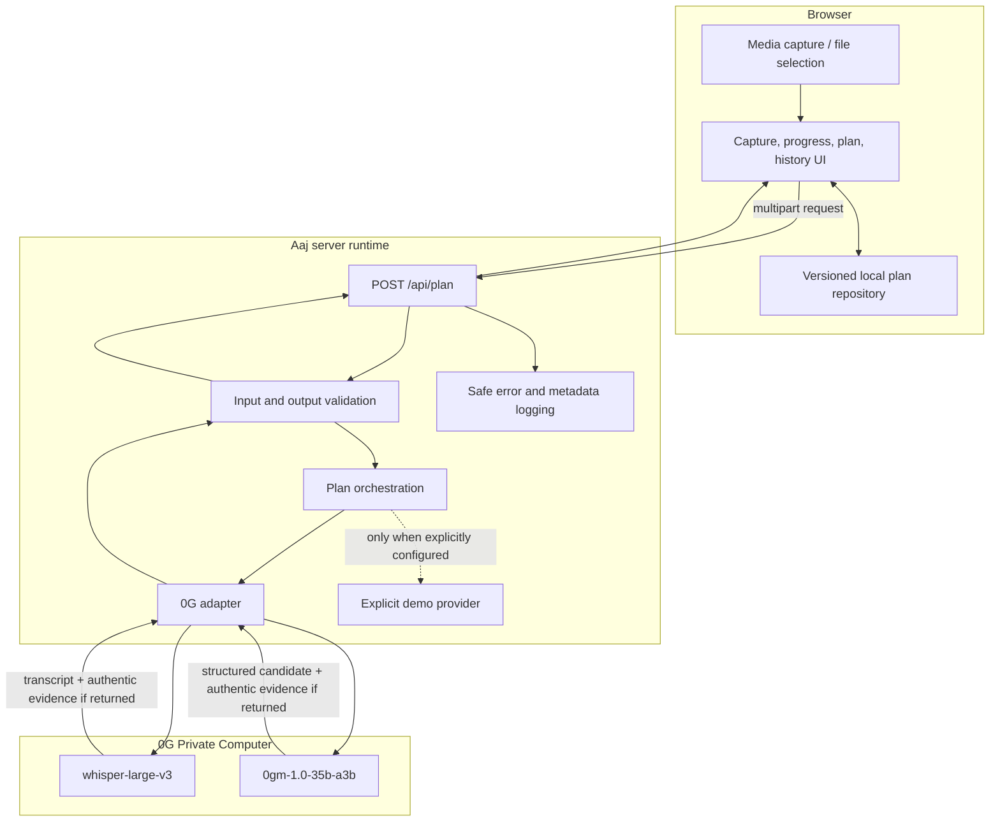

# High-level design

## Status and boundaries

This remains a proposed product architecture, not an end-to-end implementation report. Phase 0 live verification has completed real 0G transcription and planner calls: `whisper-large-v3` and `0gm-1.0-35b-a3b` both returned authentic request evidence. Deployment and the application flow remain unimplemented.

Aaj is a mobile-first PWA with a thin server boundary around two planned 0G inference operations. It retains structured plan state in the browser and intentionally has no application database, account system, contract, or background worker.

## Context



External trust boundaries:

1. **Browser ↔ Aaj server:** user-controlled input crosses into server code.
2. **Aaj server ↔ 0G:** audio and transcript leave Aaj-controlled processing for inference.
3. **Browser storage:** device-local but accessible to code running in the same origin and removable by the user/browser.

## Container architecture



### Deployment containers

- **Static/client bundle:** UI, capture capability detection, API client, local repository, and service-worker/PWA shell if implemented.
- **Server runtime:** same-origin API route and server-only configuration. It must support multipart upload size controls and a request timeout long enough for two sequential provider calls.
- **0G:** external inference provider reached only from the server runtime.
- **No database:** server instances remain stateless between requests.

## Components and responsibilities

| Component | Responsibility | Must not do |
|---|---|---|
| Capture controller | Detect recording support, record, time, stop, and create a candidate file | Claim a duration or codec it did not inspect |
| Upload validator | Enforce allowed MIME/extension combination, byte limit, and duration policy | Forward arbitrary files |
| Plan screen | Render exact plan shape, completion controls, transcript disclosure, and evidence status | Infer or manufacture provider evidence |
| History screen | Read date-keyed local records and switch dates | Fetch server history |
| Local repository | Validate, migrate, store, and erase versioned records | Persist raw audio or secrets |
| Plan API route | Authenticate configuration, parse request, map errors, set no-store response headers | Log bodies, transcript, audio, or credentials |
| Orchestrator | Run transcription then planning, enforce terminal state, assemble response | Store partial/success state server-side |
| 0G adapter | Translate internal calls to current verified 0G API shape and normalize returned evidence | Assume undocumented headers/fields or synthesize IDs |
| Output validator | Parse and validate the exact result schema | Silently truncate/expand priorities |
| Demo provider | Return deterministic sample data only when explicitly enabled | Call itself 0G, verified, private inference, or use provider request-ID fields |
| Safe logger | Record correlation ID, stage, duration, status class, and redacted error category | Record content or authorization values |

## Data flow

### Real mode

1. Browser validates basic file type/size and sends multipart form data to `POST /api/plan`.
2. Server independently validates the upload and creates an internal correlation ID. This ID is operational metadata, **not** provider evidence.
3. The adapter sends the audio to the verified live 0G speech endpoint using `whisper-large-v3` and the server-only API key.
4. The adapter obtains transcript text and captures only a provider request ID actually present in the response body or headers. The source location is recorded internally with the evidence value.
5. The orchestrator trims the transcript, rejects blank text or more than 8,000 Unicode code points, wraps the accepted transcript as a JSON-encoded untrusted-data field in a fixed planning instruction, and calls verified 0G model `0gm-1.0-35b-a3b` with JSON-object response mode, TEE verification, and private trust mode.
6. The adapter captures planning evidence only from observed `x_0g_trace.request_id`.
7. The canonical output validator parses every candidate and enforces the exact plan schema. The verified initial policy does not automatically repair or retry malformed output; it returns a typed invalid-output error. Each provider operation has a 120-second timeout and a 256 KiB successful-response limit.
8. Server returns the transcript for immediate inspection, exact structured plan, mode `real`, model labels, and evidence objects. It returns `Cache-Control: no-store`.
9. Browser stores only the structured plan, completion state, safe evidence metadata, and timestamps. It does not persist audio or transcript by default.

### Explicit demo mode

1. Demo mode exists only when a dedicated server setting allows it; missing credentials alone must not silently activate it.
2. The request returns deterministic sample output with `mode: demo`.
3. Provider evidence fields are `unavailable` and contain no request ID. A separate local sample-run identifier may start with `demo_`, but the UI must never label it a provider request ID.
4. The browser displays a persistent banner before capture, during processing, and on the result.

### Storage flow

1. On load, the local repository reads the single namespaced envelope.
2. It validates `schemaVersion`, migrates known older versions without data loss, and quarantines/ignores unreadable entries while showing recovery guidance.
3. Successful plans are upserted by local date.
4. Completion toggles update only the matching priority ID in that date’s record.
5. Erase-all removes the namespace after explicit confirmation.

## Proposed API contract

### Endpoint

`POST /api/plan`

### Request

`multipart/form-data`

| Field | Type | Required | Notes |
|---|---|---|---|
| `audio` | file | yes | One supported audio file within configured byte/duration limits |

Do not accept client-selected model, mode, system prompt, user ID, request ID, or API key. Deployment configuration owns mode and model selection.

### Success response: real mode

```json
{
  "schemaVersion": 1,
  "mode": "real",
  "transcript": "string",
  "plan": {
    "priorities": [
      { "id": "p1", "text": "string" },
      { "id": "p2", "text": "string" },
      { "id": "p3", "text": "string" }
    ],
    "blocker": "string",
    "firstStep": "string",
    "encouragement": "string"
  },
  "inference": {
    "transcription": {
      "model": "whisper-large-v3",
      "evidence": { "status": "available", "requestId": "provider-value" }
    },
    "planning": {
      "model": "0gm-1.0-35b-a3b",
      "evidence": { "status": "available", "requestId": "provider-value" }
    }
  }
}
```

Either real evidence object may instead be `{ "status": "unavailable" }` when the provider returned no ID. A successful inference is not automatically “verified” in the UI; UI copy must reflect the actual evidence state.

### Success response: demo mode

```json
{
  "schemaVersion": 1,
  "mode": "demo",
  "sampleRunId": "demo_local_identifier",
  "transcript": "Clearly labeled sample transcript",
  "plan": {
    "priorities": [
      { "id": "p1", "text": "Sample priority" },
      { "id": "p2", "text": "Sample priority" },
      { "id": "p3", "text": "Sample priority" }
    ],
    "blocker": "Sample blocker",
    "firstStep": "Sample first step",
    "encouragement": "Sample encouragement"
  },
  "inference": {
    "transcription": { "model": null, "evidence": { "status": "unavailable" } },
    "planning": { "model": null, "evidence": { "status": "unavailable" } }
  }
}
```

### Error response

```json
{
  "error": {
    "code": "INVALID_AUDIO",
    "message": "User-safe corrective message",
    "retryable": false,
    "correlationId": "internal-operational-id"
  }
}
```

Codes are fixed as `INVALID_AUDIO`, `AUDIO_TOO_LARGE`, `AUDIO_TOO_LONG`, `CONFIGURATION_ERROR`, `TRANSCRIPTION_FAILED`, `PLANNING_FAILED`, `INVALID_MODEL_OUTPUT`, `UPSTREAM_TIMEOUT`, `RATE_LIMITED`, and `INTERNAL_ERROR`. Each code has a stable message, HTTP status, and retryable value. Correlation IDs aid support and are never described as 0G request IDs; raw provider bodies, errors, stacks, authorization values, prompts, and transcripts never enter this response.

## Data model

### Domain plan

- `priorities`: tuple of exactly three `{id, text}` items; IDs are stable within a stored plan.
- `blocker`: non-empty concise text. “No clear blocker identified” is allowed when grounded in the transcript.
- `firstStep`: one concrete action, not a list.
- `encouragement`: one short sentence without unsupported promises.

### Local storage envelope

```json
{
  "schemaVersion": 1,
  "updatedAt": "ISO-8601 timestamp",
  "plansByDate": {
    "YYYY-MM-DD": {
      "createdAt": "ISO-8601 timestamp",
      "mode": "real",
      "plan": {},
      "completedPriorityIds": ["p1"],
      "inference": {}
    }
  }
}
```

The key is a local-calendar date produced in the browser. Evidence metadata may be retained with the structured plan; transcript and audio are excluded by default. A bounded recent-history policy may be added only after the MVP contract is tested and documented.

## 0G adapter and evidence handling

The adapter exposes internal operations such as `transcribe(audio)` and `createPlan(transcript)` while hiding the provider SDK/HTTP shape. The live implementation must begin from observed 0G responses, not the draft assumptions here.

Evidence normalization rules:

1. Maintain an explicit allowlist of verified response header/body locations after a real call.
2. Copy the provider value exactly except safe transport decoding; do not hash, prefix, repair, or replace it.
3. Preserve stage association: transcription evidence cannot stand in for planning evidence.
4. Never fall back to an Aaj correlation ID, timestamp, UUID, sample ID, or response hash.
5. Treat missing/empty evidence as `unavailable` and adjust UI language.
6. Redact evidence from public logs if provider documentation says it is sensitive; the browser may display it for the user/judge only after that risk is assessed.
7. Record a fixture from a sanitized real response shape for contract tests only after secrets and content are removed.

## Security, privacy, and threat model

### Assets

- `ZERO_G_API_KEY` and any future provider credentials.
- User voice, transcript, priorities, and blocker.
- Integrity of real/demo labels and provider evidence.
- Availability of the inference endpoint and user quota.

### Threats and controls

| Threat | Control |
|---|---|
| Client bundle or response exposes API key | Server-only environment read; server-only adapter module; bundle/string scan; no error passthrough |
| Oversized or malicious upload exhausts memory/quota | Platform body limit, streaming/bounded parse where supported, type/size/duration checks, request timeout, rate limiting before launch |
| Prompt injection in spoken text alters schema/instructions | Delimit transcript as untrusted data, fixed instruction, strict output validation, no tool execution |
| Provider error leaks headers or content | Map to typed safe errors; redact authorization, bodies, transcript, request IDs as policy requires |
| Cross-site request abuse consumes quota | Same-origin endpoint, origin/CSRF strategy appropriate to hosting, rate limits, deployment abuse monitoring |
| Stored XSS from model text | Render as text, never HTML; browser CSP and framework escaping |
| Simulated evidence presented as real | Discriminated response union, persistent labels, evidence unavailable in demo mode, tests for prohibited copy |
| Local history read by another device user or same-origin script | Plain disclosure; strong CSP; minimal dependencies; erase-all; no claim of encrypted local storage |
| Server/provider retention misunderstood | State only Aaj’s behavior; document provider policy separately when verified |
| Replay/double submission | Disable while active; idempotency is not promised; retry creates a new run and evidence set |

### Privacy statement design

“Aaj does not retain raw audio or server-side plan history” is an Aaj architecture claim to verify in code and hosting logs. It is not equivalent to “audio never leaves the device” or “0G retains nothing.” Provider privacy/retention language remains TBD until supported by current documentation.

## Observability

Use content-free structured events:

- correlation ID;
- route/stage (`validation`, `transcription`, `planning`, `response`);
- mode;
- started/finished timestamps or duration;
- status and safe error code;
- file byte-size bucket and MIME category if useful;
- evidence presence booleans, not invented values;
- configured model label.

Do not log audio, transcript, generated plan, authorization headers, multipart bodies, or full upstream errors. No user analytics are required for MVP. During judging, an on-screen evidence panel is the primary integration proof; server logs are a redacted diagnostic fallback.

## Failure modes

| Failure | User state | Persistence | Retry |
|---|---|---|---|
| Microphone denied/unsupported | Inline capture guidance + upload option | none | after permission change/upload |
| Invalid file | Specific validation message | none | after selecting valid file |
| 0G auth/config error | Service configuration message; never auto-demo | none | operator fix |
| Transcription timeout/error | Transcription failed | none | new request |
| Empty transcript | Could-not-understand message | none | re-record |
| Planning timeout/error | Planning failed; transcript may be shown for current view only | none | new planning run only if contract safely supports it; otherwise full retry |
| Invalid model output | Invalid-output message | none | bounded server retry, then user retry |
| Missing request ID | Plan shown with evidence unavailable | successful plan may persist | valid product behavior, but blocks readiness for the selected prize; seek sponsor clarification and do not submit as qualified |
| Local storage full/blocked | Plan remains in current view; persistence warning | no/partial write rolled back | clear space or continue ephemeral |
| Corrupt stored data | Recovery notice; preserve raw envelope for export only if safely feasible | no silent overwrite | erase/reset after confirmation |

## Deployment assumptions

- HTTPS is required for production microphone access.
- The hosting runtime can keep `ZERO_G_API_KEY` secret and accept bounded multipart uploads.
- The runtime permits outbound HTTPS to the verified 0G API endpoint.
- The request deadline accommodates measured sequential-call latency; otherwise architecture must change explicitly.
- A single origin serves UI and API to simplify security and deployment.
- No edge-runtime compatibility is assumed until the selected SDK and multipart behavior are tested.
- Server environment variables are `ZERO_G_API_KEY`, `ZERO_G_PLANNER_MODEL`, and `AAJ_DEMO_MODE`. `AAJ_DEMO_MODE` accepts only exact `true` or `false`; absent/`false` selects real mode, while `true` explicitly selects demo mode. Real mode requires a nonblank key and the exact verified planner model `0gm-1.0-35b-a3b`.

## Architecture decisions

- [ADR-0001: Target a single 0G prize](adr/0001-single-0g-prize.md)
- [ADR-0002: Build a mobile-first PWA](adr/0002-web-pwa-over-native.md)
- [ADR-0003: Keep history local](adr/0003-local-first-history.md)
- [ADR-0004: Never fabricate provider evidence](adr/0004-no-fake-evidence.md)
